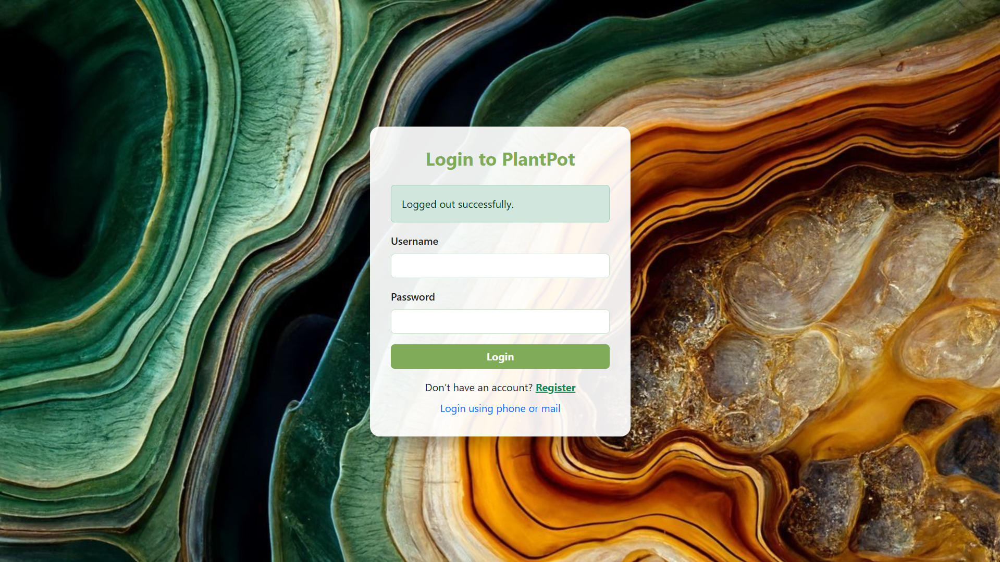
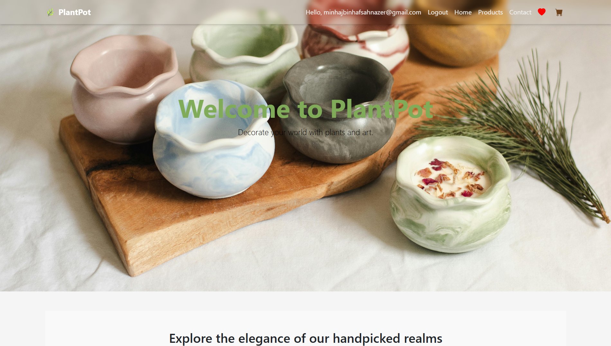
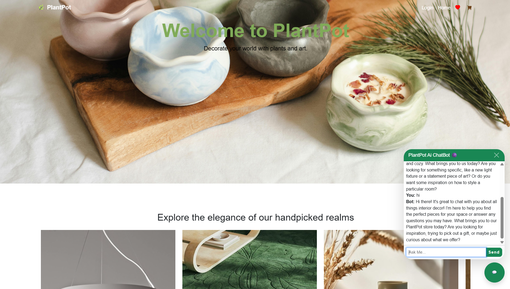
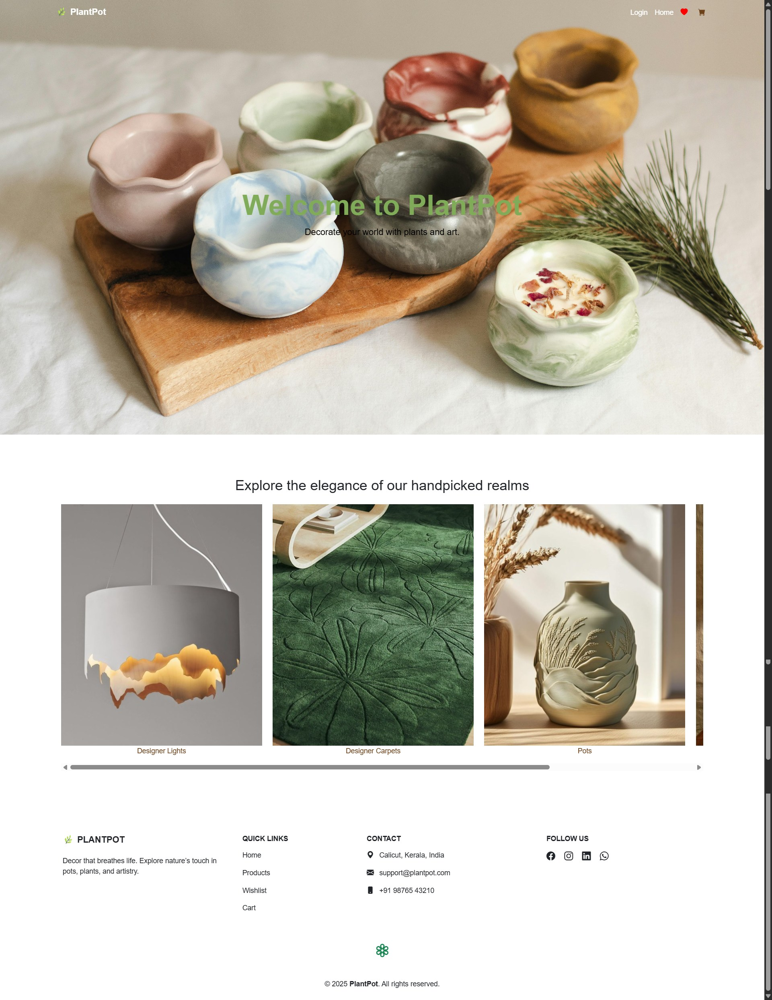
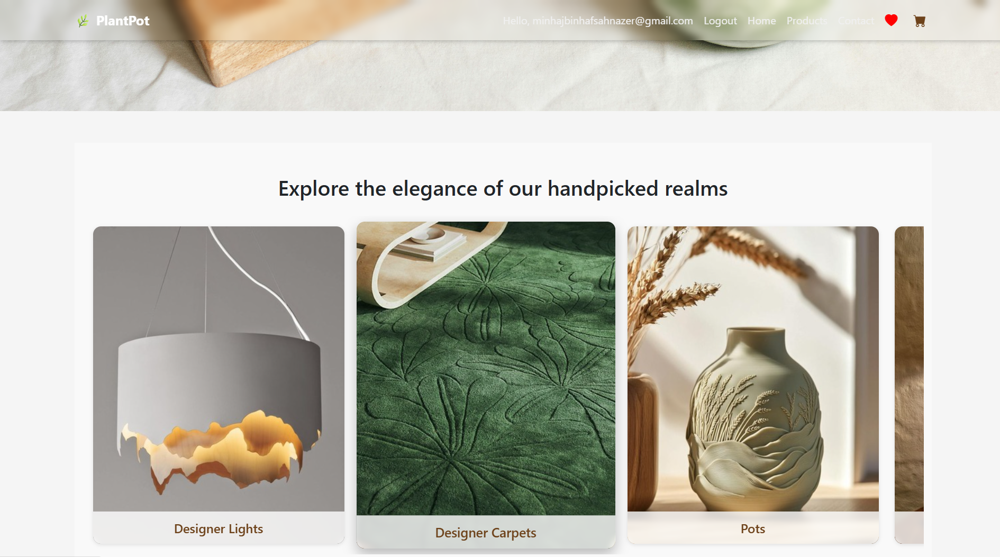
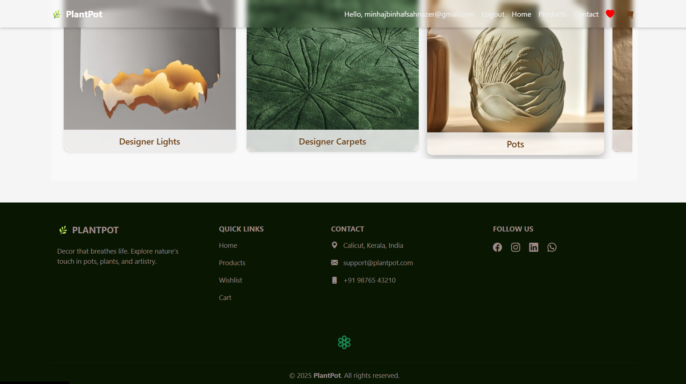
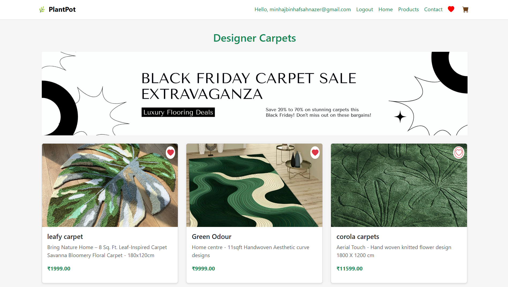
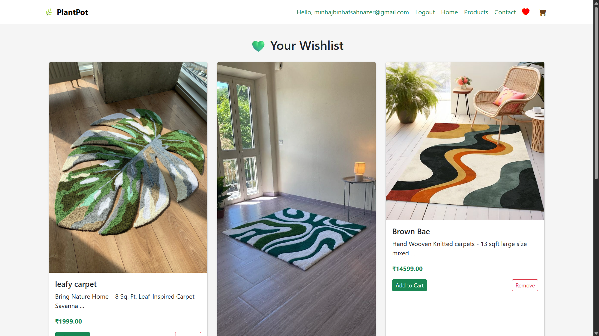
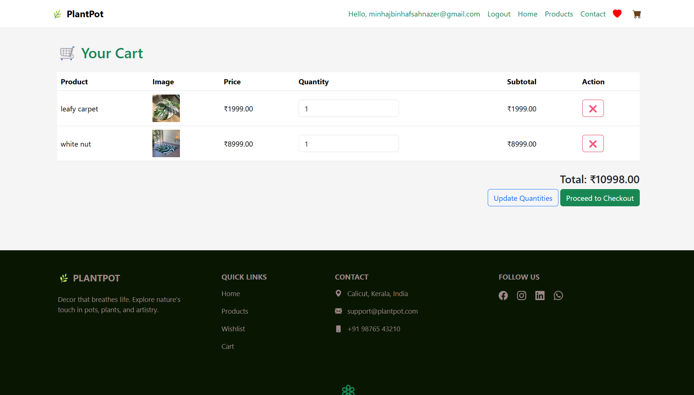
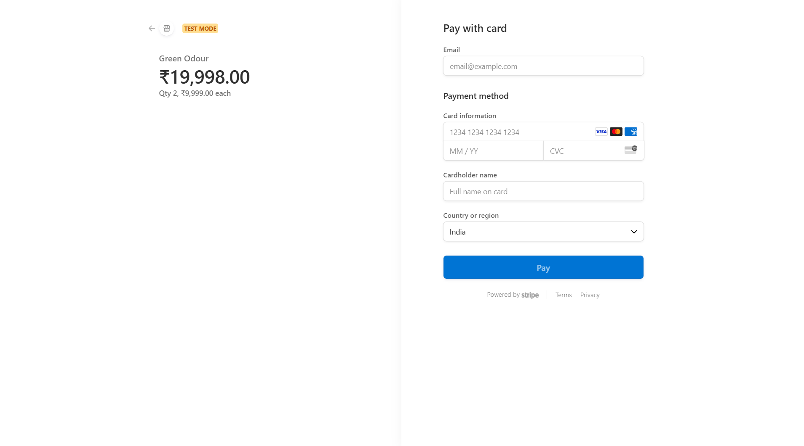

# 🪴 PlantPot — E-commerce Platform With Built-In AI Assistant (Google Gemini)
# For Interior Decor & Designer Goods 

PlantPot is a Django-powered e-commerce platform crafted for selling Carpets, Pots, Lights, interior decorations, furniture, and artisanal pieces. It includes a smart AI styling & shopping assistant powered by Google Gemini, grounded dynamically on real store inventory.

# login page

# nav-bar & hero

# Ai ChatBot

# full home page

# home page

# home page & footer

# product listings

# wishlist

# checkout

# payment


---

## ✨ Features

- 🛍️ **Product Listings** with categories (plants, decor, furniture, lighting, carpets)
- 💡 **Built-in AI Assistant** powered by **Google Gemini API** (`gemini-2.5-flash`), with live catalog grounding
- 🔍 **Product Detail View** with price, description, and image
- 🧡 **Wishlist** system with toggle support
- 🛒 **Shopping Cart** with quantity updates and subtotal calculation
- 🔐 **User Authentication** (login, register, logout, OTP login support)
- 🎊 **Confetti greeting animation** on OTP login
- 💬 **Toast alerts** for cart/wishlist actions
- 📱 Fully **responsive UI** with Bootstrap 5
- 🎨 Clean, modern layout with a sleek floating AI chatbot widget

---

## 📦 Tech Stack

| Layer         | Technology                                                                |
|---------------|---------------------------------------------------------------------------|
| Backend       | Django — RESTful architecture, clean MVT design                           |
| AI Assistant  | Google Gemini API (`google-genai`, `gemini-2.5-flash`)                    |
| Frontend      | HTML, CSS, Bootstrap 5, JavaScript — fully responsive UI                  |
| Auth System   | Django Auth + OTP-based login — secure and mobile-friendly authentication |
| Cart & Order  | Dynamic cart with quantity updates, item removal, subtotal calculations   |
| Wishlist      | Persistent wishlist with toggle feature                                   |
| Database      | SQLite for development, MySQL for production                              |
| Static/Media  | Django's static/media handling — supports image upload for products       |
| Payment       | Ready for integration with Stripe (WIP)                                   |
| Responsiveness| Fully mobile-optimized: form flows, modals, and navbar                    |

---

## 🚀 Getting Started

### 1. Clone & Setup

```bash
git clone https://github.com/yourusername/plantpot.git
cd plantpot
```

### 2. Activate Virtual Environment & Install Dependencies

```powershell
.\venv\Scripts\Activate.ps1
pip install -r requirements.txt  # or: pip install google-genai python-dotenv django
```

### 3. Configure Environment Variables

Create a `.env` file in the root directory:
```env
GEMINI_API_KEY=your_gemini_api_key_here
```
> 💡 *You can get a free Gemini API key from [Google AI Studio](https://aistudio.google.com/).*

### 4. Run the Development Server

```powershell
python manage.py runserver
```

Open `http://127.0.0.1:8000/` in your browser!
